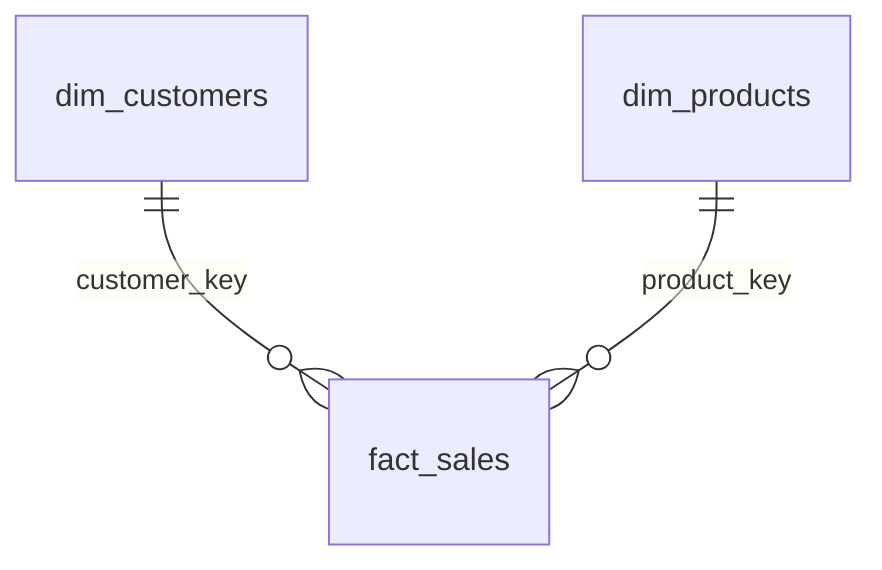

# 📊 SQL Data Analytics Project

An end-to-end **SQL data analytics project** built on a retail (bike store) data warehouse using **Microsoft SQL Server**.
The project goes from basic exploration (EDA) to **advanced analytics** — trends, cumulative metrics, performance, part-to-whole, segmentation — and finishes with two reusable **business reports (views)** for customers and products.


---

## 🎯 Project Objectives

- Explore the structure and content of a star-schema data warehouse.
- Answer real business questions with SQL (aggregations, window functions, CTEs, CASE logic).
- Track **sales trends** over time and measure **year-over-year performance**.
- **Segment** customers and products for targeted decisions.
- Build **reporting views** that can be plugged directly into BI tools (Power BI / Tableau).

---

## 🗂️ Dataset

Star schema with one fact table and two dimensions (`datasets/flat-files`):

| Table | Rows | Description |
|---|---|---|
| `fact_sales` | 60,398 | Order lines: order/ship/due dates, sales amount, quantity, price |
| `dim_customers` | 18,484 | Customer demographics: country, gender, marital status, birthdate |
| `dim_products` | 295 | Product attributes: category, subcategory, cost, product line |



---

## 🧭 Project Roadmap


### Exploratory Data Analysis (`scripts/01` – `06`)
| # | Script | What it does |
|---|---|---|
| 01 | [Database Exploration](scripts/01_database_exploration.sql) | Inspect tables & columns via `INFORMATION_SCHEMA` |
| 02 | [Dimensions Exploration](scripts/02_dimensions_exploration.sql) | Unique countries, categories, subcategories |
| 03 | [Date Range Exploration](scripts/03_date_range_exploration.sql) | First/last order, customer age range |
| 04 | [Measures Exploration](scripts/04_measures_exploration.sql) | Key business KPIs in one report |
| 05 | [Magnitude Analysis](scripts/05_magnitude_analysis.sql) | Measures by dimension (country, gender, category) |
| 06 | [Ranking Analysis](scripts/06_ranking_analysis.sql) | Top/bottom N products and customers |

### Advanced Analytics — ⭐ [`Data_analyse_Queries.sql`](Data_analyse_Queries.sql)
| # | Analysis | Technique |
|---|---|---|
| 1 | **Change Over Time** | `DATETRUNC`, `YEAR`, `MONTH`, `FORMAT` + `GROUP BY` |
| 2 | **Cumulative Analysis** | Running total & moving average with `SUM/AVG() OVER (ORDER BY …)` |
| 3 | **Performance Analysis** | YoY with `LAG()`, comparison vs. average with `AVG() OVER (PARTITION BY …)` |
| 4 | **Part-to-Whole** | `% of total` using `SUM() OVER ()` |
| 5 | **Data Segmentation** | Cost ranges & VIP/Regular/New customers with `CASE` |
| 6 | **Customer Report** | View `dbo.report_customers` |
| 7 | **Product Report** | View `dbo.report_products` |

> The reference scripts `07`–`13` in `scripts/` cover the same advanced topics individually.

---

## 💡 Key Insights

| Area | Finding |
|---|---|
| **Overall** | ~**29.4M** in revenue from **27,659 orders**, **60,423 items** and **18,484 customers** (Dec 2010 – Jan 2014). |
| **Trend** | 2013 was the peak year (**16.3M**, 17K+ customers). 2012 revenue dipped vs. 2011 while customers kept growing → shift toward cheaper products. |
| **Part-to-Whole** | **Bikes = 96.5%** of revenue; Accessories 2.4%, Clothing 1.2% → heavy dependency on one category. |
| **Top Products** | The *Mountain-200* family dominates the top 5 products (~1.3M each). |
| **Geography** | **United States** (9.16M) and **Australia** (9.06M) together generate ~62% of sales. |
| **Customers** | **1,655 VIP** customers (9%) generate **10.8M (~37%)** of revenue; 14,631 are *New* (lifespan < 12 months). |
| **Products** | **66 High-Performer** products bring ~94% of revenue; 110 of 295 products cost below 100. |

**Recommendations**
1. Grow Accessories & Clothing via bundles/cross-selling with bike purchases to reduce category risk.
2. Launch a loyalty program to convert the large *New* base into *Regular*/*VIP* customers.
3. Protect the US & Australia markets while testing campaigns in UK, Germany and France.

---

## 🧾 Reports (Views)

**`dbo.report_customers`** – one row per customer
`customer_name, age, age_group, customer_segment, last_order_date, recency, total_orders, total_sales, total_quantity, total_products, lifespan, avg_order_value, avg_monthly_spend`

**`dbo.report_products`** – one row per product
`product_name, category, subcategory, cost, last_sale_date, recency_in_months, product_segment, lifespan, total_orders, total_sales, total_quantity, total_customers, avg_selling_price, avg_order_revenue, avg_monthly_revenue`

```sql
SELECT customer_segment, COUNT(*) AS customers, SUM(total_sales) AS sales
FROM dbo.report_customers
GROUP BY customer_segment;
```

---

## 🚀 How to Run

**Requirements:** SQL Server 2022+ (Express/Developer – free) and SSMS or Azure Data Studio. `DATETRUNC()` needs SQL Server 2022.

**Option A – Restore backup (fastest)**
1. In SSMS: *Databases → Restore Database → Device* → select `datasets/DataWarehouseAnalytics.bak`.

**Option B – Import CSV files**
1. Run `scripts/00_init_database.sql` after updating the `BULK INSERT` paths to your local `datasets/flat-files/*.csv` files.
   *(This project's queries use the `dbo` schema; change `gold.` to `dbo.` in the init script, or vice-versa in the queries.)*

Then open **`Data_analyse_Queries.sql`** and execute section by section.

---

## 📁 Repository Structure

```
sql-data-analytics-project/
├── Data_analyse_Queries.sql      # ⭐ Main advanced analytics script (my work)
├── datasets/
│   ├── DataWarehouseAnalytics.bak
│   └── flat-files/               # dim_customers.csv, dim_products.csv, fact_sales.csv
├── docs/                         # Project roadmap & notes
├── scripts/                      # 00–13 step-by-step analysis scripts
├── LICENSE
└── README.md
```

---

## 🛠️ SQL Skills Demonstrated

`Joins` · `Aggregations` · `CTEs` · `Subqueries` · `Window Functions (SUM/AVG OVER, LAG, PARTITION BY)` · `CASE segmentation` · `Date functions (DATETRUNC, DATEDIFF, FORMAT)` · `Views for reporting`

---

## 🙏 Acknowledgements

Built while following the **SQL Data Analytics Project** tutorial by [Data With Baraa](https://www.youtube.com/@datawithbaraa) ([video](https://youtu.be/2jGhQpbzHes)). Dataset and reference scripts © Baraa Khatib Salkini, used under the [MIT License](LICENSE).

## 👤 About Me

**Mohit** – aspiring Data Analyst passionate about turning data into decisions.

[](https://github.com/mohetto-creator)
